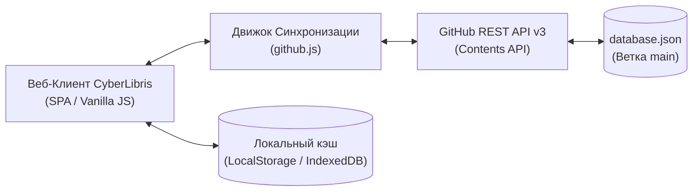

# CyberLibris — Нео-Библиотека & Геймифицированный Хаб Знаний

> **Учебная дисциплина:** Технологии программирования  
> **Проект:** Полнофункциональное клиент-серверное веб-приложение с подключением к GitHub и хостингом базы данных в репозитории  
> **Версия:** 2.4.0  
> **Статус:** Production Ready  

---

## 1. Концепция и Идея Проекта

**CyberLibris** — это веб-платформа нового поколения, объединяющая в себе современную интерактивную электронную библиотеку, эстетику киберпанка/нео-футуризма и глубокую RPG-геймификацию. 

В отличие от классических скучных каталогов, CyberLibris превращает процесс чтения в интерактивное приключение:
* **Чтение вознаграждается:** за каждую минуту, проведенную в читальном зале, читатель получает опыт (**XP**) и внутреннюю валюту (**Люмены ⬡**).
* **Интеллектуальные мини-игры:** для переключения внимания и тренировки когнитивных способностей в платформу интегрированы 3 полноценные мини-игры (*«Словесный Шторм»*, *«Кибер-Криптор»* и *«Матрица Памяти»*).
* **Персонализация и статус:** победы в играх и чтение книг открывают эксклюзивные динамические анимированные обводки аватаров (неоновый пульс, радужный дракон, золотой триумф, плазменное пламя), живые интерактивные фоны, титулы и значки.
* **Зал Славы (Leaderboard):** публичный рейтинг пользователей наглядно выделяет продвинутых исследователей, отображая их аватары, уровни, рекорды скорости чтения (WPM) и достижения.

---

## 2. Архитектура и Организация Базы Данных в GitHub

Одной из ключевых инженерных задач являлась реализация **«БД на хостинге в GitHub»** и интеграция приложения с удаленным репозиторием без необходимости развертывания дорогостоящих серверов:



### Принцип работы GitHub-хранилища:
1. **Файл `database.json`** выступает единым источником правды (*Single Source of Truth*), хранящим коллекции пользователей, книг, глав, инвентаря кастомизаций, значков и журнала аудита.
2. **Двусторонняя синхронизация через GitHub API:**
   * **Чтение (Pull):** Приложение считывает актуальное состояние базы данных из репозитория GitHub через эндпоинт `GET /repos/{owner}/{repo}/contents/database.json`.
   * **Запись (Push / Commit):** Любые изменения (регистрация, покупка кастомизаций, добавление книг администратором, прогресс чтения) автоматически фиксируются в репозитории через `PUT /repos/{owner}/{repo}/contents/database.json` с кодированием в UTF-8 Base64, обновлением SHA файла и созданием коммита.
3. **Гибридный отказоустойчивый режим:**
   * Приложение работает из коробки в режиме **Simulated GitHub Cloud** даже при отсутствии интернета или токена.
   * При указании GitHub Personal Access Token (PAT) в модальном окне «Интеграция с GitHub» активируется реальный **Live REST API** режим.

---

## 3. Ролевая Модель и Аутентификация

В системе реализовано разграничение прав доступа на базе ролей (**RBAC**):

| Роль | Права и возможности | Тестовый аккаунт |
| :--- | :--- | :--- |
| **Администратор (ADMIN)** | Полный доступ к ядру: Консоль управления, добавление/редактирование/удаление книг, назначение ролей пользователям, начисление Люменов, экспорт/импорт базы данных в JSON, принудительный коммит в GitHub, просмотр журнала аудита. | **Логин:** `admin`<br/>**Пароль:** `admin123` |
| **Читатель (USER)** | Персональный профиль, чтение произведений, закладки и заметки, прохождение мини-игры, покупка кастомизаций в гардеробе, участие в Зале Славы. | **Логин:** `cyber_scholar`<br/>**Пароль:** `scholar123` |
| **Новый читатель** | Свободная регистрация в модальном окне с выбором стартового аватара и приветственным бонусом (+100 ⬡). | *Регистрируется через форму* |

> [!TIP]
> Для быстрого тестирования в окне входа предусмотрены кнопки быстрого входа в 1 клик: **«⚡ Войти как Admin»** и **«📖 Войти как Читатель»**.

---

## 4. Прогрессивный Визуал и Интерактивность («Свистоперделки»)

* **Реагирующий Canvas-фон:**
  * Фоновый холст в реальном времени отслеживает движение курсора и клики мыши, просчитывая физику частиц.
  * Доступно **5 переключаемых живых тем**:
    1. *Неоновый Киберпанк* — гравитационная паутина из светящихся частиц и фотонных линий;
    2. *Космическая Туманность* — трехслойный параллакс звезд и пульсирующий газ;
    3. *Уютный Янтарь* — парящие угольки и теплое свечение старинной библиотеки;
    4. *Изумрудная Матрица* — цифровой дождь с откликом на курсор;
    5. *Полярная Аврора* — золотистые волновые переливы северного сияния.
* **3D Tilt-эффект карточек:**
  * Все карточки книг, профилей и товаров реагируют на движение мыши реалистичным трехмерным наклоном с сохранением перспективы (`perspective(1000px)`).
* **Магнитные кнопки:**
  * Элементы управления мягко притягиваются к указателю мыши при наведении.
* **Анимированные обводки и аватары:**
  * Рамки со сложными CSS-эффектами: вращающийся конический спектр (`frame-dragon`), неоновая пульсация (`frame-neon`), хроматический глитч (`frame-void`), королевское золото (`frame-gold`), плазменный огонь (`frame-flame`).
* **Процедурный синтезатор звука (Web Audio API):**
  * Полностью автономный звуковой движок без внешних MP3-файлов: клики кнопок, микро-бипы наведения, шелест переворота карт, аккорды правильных ответов, триумфальные фанфары при повышении уровня и фоновые генераторы атмосферы (шум дождя, кибер-гул, фокус-тон 432 Гц).

---

## 5. Игровой Центр (Mini-Games)

В платформу встроены 3 мини-игры для тренировки ума и заработка игровой валюты:

1. **⚡ Словесный Шторм (Speed Rush):**
   * Аркадный тест на скорость чтения и реакцию. 
   * Игрок за 30 секунд должен находить правильные совпадения терминов, наращивая комбо-множитель до x5.
2. **🧩 Кибер-Криптор:**
   * Криптографическая головоломка по расшифровке цитат классиков литературы и мыслителей IT (Булгаков, Гибсон, Фаулер, Дейкстра, Сунь-Цзы).
   * Игрок отгадывает буквы, сохраняя защитные щиты.
3. **🧠 Матрица Памяти (Memory Matrix):**
   * Тренажер памяти с 3D-переворотом неоновых карточек (Git Commit, Push, Octocat, Clean Code, ИИ, Квантовый чип).
   * Оценка качества прохождения по количеству ходов.

---

## 6. Читальный Зал и Спринтер-Чтение (RSVP Spritz)

* Читательский зал с главами, настраиваемым размером шрифта, выбором гарнитур (Sans, Serif, Mono) и цветовыми темами оформления (*Dark, OLED Black, Sepia, Cyberpunk, Paper Ivory*).
* **Режим скорочтения RSVP (Rapid Serial Visual Presentation):**
  * Текст отображается по одному слову с фиксированной точкой оптимального распознавания (**ORP**), выделенной цветом.
  * Позволяет читать со скоростью от 150 до 800 слов в минуту без утомления глаз!
* **Атмосферный плеер:**
  * Встроенные генераторы шума дождя, городского неона и бинауральных ритмов для глубокой концентрации.
* **Закладки и заметки:**
  * Сохранение цитат с персональными комментариями читателя.

---

## 7. Запуск и Развертывание

### Локальный запуск (Windows):
1. Дважды кликните по файлу **`run.bat`**  
   *(Скрипт автоматически запустит локальный веб-сервер Python и откроет приложение в браузере по адресу `http://localhost:8080`)*.
2. Либо запустите в командной строке:
   ```powershell
   python server.py
   ```
3. Либо просто откройте файл **`index.html`** в любом современном браузере.

### Развертывание на GitHub Pages (Бесплатный хостинг):
1. Инициализируйте репозиторий в папке и отправьте файлы на GitHub:
   ```bash
   git init
   git add .
   git commit -m "Initial commit of CyberLibris"
   git remote add origin https://github.com/ВАШ_ЛОГИН/ВАШ_РЕПОЗИТОРИЙ.git
   git branch -M main
   git push -u origin main
   ```
2. В репозитории на GitHub перейдите в **Settings → Pages**:
   * В разделе **Build and deployment → Source** выберите **GitHub Actions** (в проекте уже подготовлен готовый файл `.github/workflows/deploy.yml`).
3. Через 1 минуту ваше веб-приложение станет доступно по глобальному адресу:
   `https://ВАШ_ЛОГИН.github.io/ВАШ_РЕПОЗИТОРИЙ/`

---

## 8. Структура Проекта

```
Технологии программирования/
├── .github/
│   └── workflows/
│       └── deploy.yml        # CI/CD автоматический деплой на GitHub Pages
├── css/
│   ├── main.css              # Базовые стили, адаптивная сетка, неоновая палитра
│   ├── animations.css        # Анимации обводок, 3D-эффекты, глитч, фанфары
│   ├── reader.css            # Оформление читального зала и спринтер-чтения RSVP
│   └── games.css             # Стили для 3 мини-игр и гардероба кастомизации
├── js/
│   ├── app.js                # Главный координатор, маршрутизация, модальные окна
│   ├── audio.js              # Процедурный Web Audio API звуковой синтезатор
│   ├── background.js         # Интерактивный реагирующий Canvas с 5 темами
│   ├── github.js             # Коннектор к GitHub REST API (Contents API)
│   ├── db.js                 # Реактивная база данных и кэширование
│   ├── auth.js               # Аутентификация, прогрессия уровней, права ролей
│   ├── reader.js             # Логика читального зала, RSVP-движок, закладки
│   ├── games.js              # Игровой хаб (Speed Rush, Cryptor, Memory) и магазин
│   └── admin.js              # Панель управления администратора, аудит, CRUD
├── database.json             # Исходная база данных (книги, пользователи, косметика)
├── index.html                # Главная страница веб-приложения (SPA)
├── server.py                 # Локальный сервер на Python со встроенным CORS
├── run.bat                   # Быстрый запуск в 1 клик для Windows
└── README.md                 # Документация проекта
```
